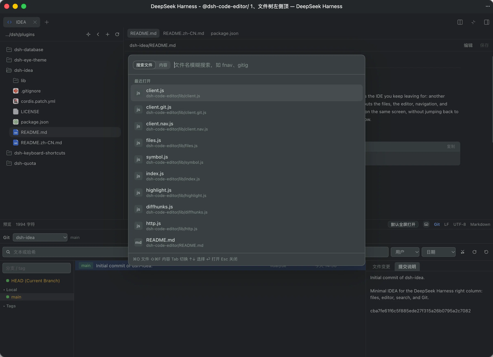
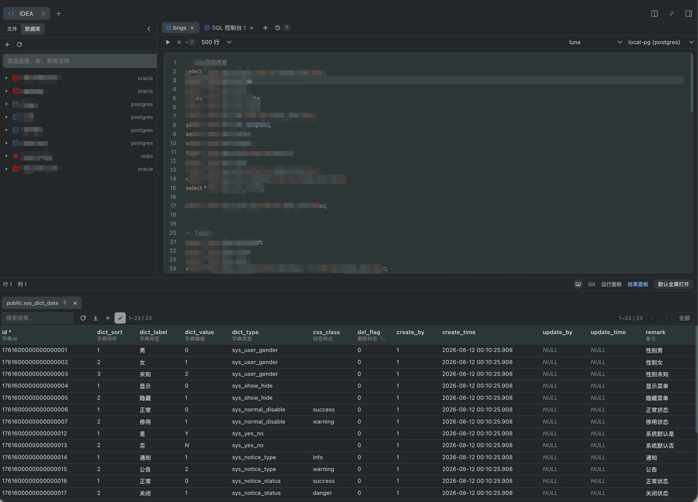

# dsh-idea

English | [中文](README.zh-CN.md)

A minimal IDEA in the DeepSeek Harness right column.





## Install

```sh
dsh plugin --profile web add /absolute/path/to/dsh-idea
```

Restart `dsh web`, then refresh the page.

## Features

- Workspace file tree: browse by folder, and create, rename, or delete files and folders; copy, cut, and paste files and folders (a repeat name is numbered, never overwritten), and import files or whole folders by dragging them in from the Finder or Explorer, or pasting them
- Text editor: syntax color, find, and save
- Markdown preview, with a switch between preview and source
- Search file names, and search inside file contents
- Language servers: go to definition, go to implementation, and find references. A binary on `PATH` is used; otherwise the status bar says none is available
  - JavaScript / TypeScript: `npm install -g typescript-language-server typescript`
  - Python: `npm install -g pyright`
  - Rust: `rustup component add rust-analyzer`
  - Go: `go install golang.org/x/tools/gopls@latest`
  - C / C++: install `clangd` (usually with LLVM)
  - Java: install `jindex` ([java-index](https://github.com/slgobinath/java-index))
  - Lua: install `lua-language-server`
- Git: branches and history, diff, commit, pull, and push. The workspace root is included when it is a repository. Immediate child directories with their own `.git` are listed too, and the panel switches between them
- Run panel: start and stop discovered applications (Maven/Gradle Spring Boot, concrete JS monorepo dev servers, sibling frontends) and entries in `.dsh/run.json`. Option+F12 / Alt+F12 toggles it
- Database explorer: connect to PostgreSQL, MySQL, Oracle, or Redis. Browse schemas, tables, and columns; preview data in the grid and edit it in place, cell by cell or by inserting a row; export a table, a schema, or a whole database as SQL (Redis as JSON), or run a script to import it back. Each connection opens a SQL console, and Redis gets key browsing and a command console. Passwords live in the DSH credential store; a host without that service keeps them in `~/.dsh/database-connections.json`
- Select text in a file and mention that range in chat with a shortcut (default `⌥⌘I` / `Ctrl+Alt+I`). With no selection, the shortcut mentions the current file

## Workspace boundary

Every panel is confined to the directories this host has already opened: the Workspace registry, the live sessions' working directories, and the sandbox policy's roots. A request naming any other directory is answered `403 cwd-not-workspace` before a single file is touched, and the credential files DSH writes under `~/.dsh` are never readable or searchable from the editor.

A deployment whose workspaces come from somewhere else can add roots with `DSH_IDEA_EXTRA_ROOTS` (a path list, `:` on POSIX, `;` on Windows).

The database panel boots on idle rather than on the critical path; opening the panel, pressing its shortcut, or leaving it open in the previous session loads it immediately.

## License

[MIT](LICENSE)
