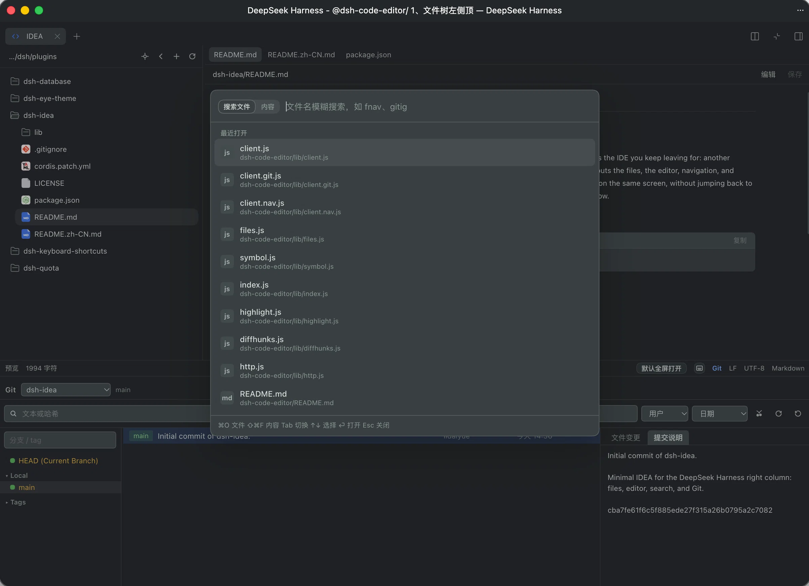

dsh-idea

[English](README.md) | 中文

DSH 右栏里的极简 IDEA。

用 Agent 同时推进几个项目时，拖慢你的往往不是模型，而是旁边那个越开越沉的 IDEA：切窗口、等索引。dsh-idea 把文件、编辑、跳转和多仓库 Git 放进 DeepSeek Harness 的右栏。Agent 在写，你在同一块屏幕上看、改、提交，不用为了看一眼代码再跳回 IDEA。它跑在 PWA 里，几乎不额外占资源，就是为了在这条工作流里把 IDEA 换掉。



## 安装

```sh
dsh plugin --profile web add /absolute/path/to/dsh-idea
```

装上后重启 `dsh web`，再刷新页面。

## 特性

- 工作区文件树：按层浏览，新建、重命名、删除文件和文件夹
- 文本编辑：语法着色、查找、保存
- Markdown 预览，可在预览和源码之间切换
- 支持搜索文件名及文件内容跳转
- 语言服务器：跳转到定义、实现，并查找引用。可执行文件在 `PATH` 中即启用，没有则状态栏提示
  - JavaScript / TypeScript：`npm install -g typescript-language-server typescript`
  - Python：`npm install -g pyright`
  - Rust：`rustup component add rust-analyzer`
  - Go：`go install golang.org/x/tools/gopls@latest`
  - C / C++：安装 `clangd`（一般随 LLVM）
  - Java：安装 `jdtls`
  - Lua：安装 `lua-language-server`
- Git：分支与历史、diff、提交、拉取、推送。工作区根如果是仓库会管理它；下一层各自带 `.git` 的目录也会列出，在面板里切换
- 快捷操作：状态栏打开快捷键列表，点击按键重新录制，也可清除或恢复默认。键位存在本插件里，不依赖其他插件
- 选中文件内容后，用快捷键把选区 @ 到对话（默认 `⌥⌘I` / `Ctrl+Alt+I`）；没有选区时引用当前文件

## 许可证

[MIT](LICENSE)
